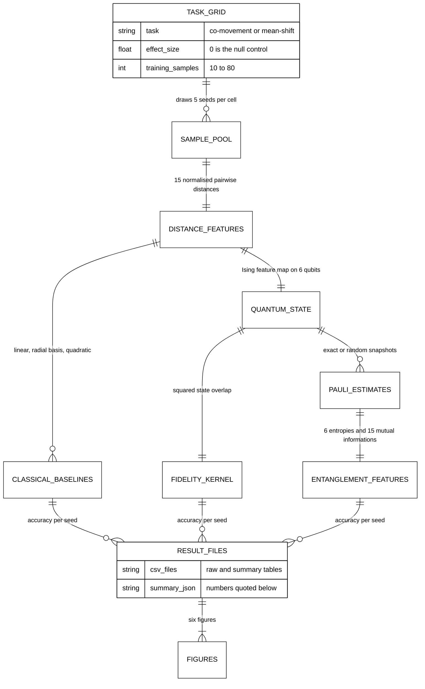
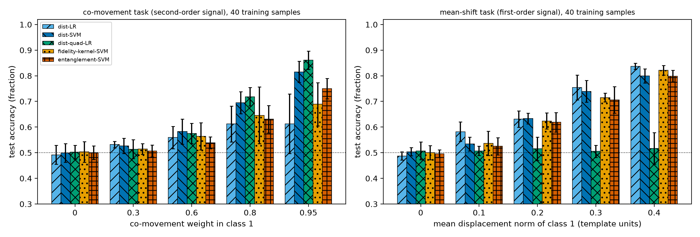
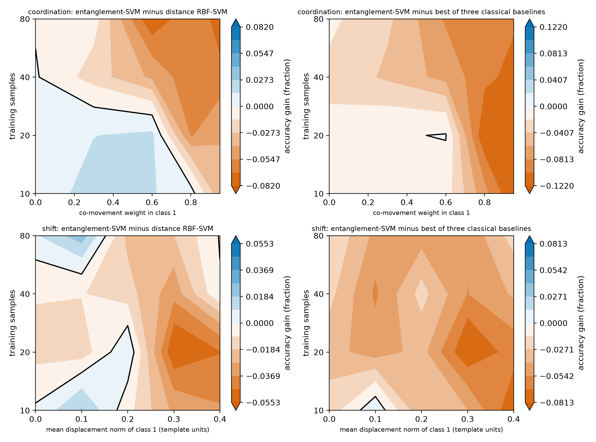
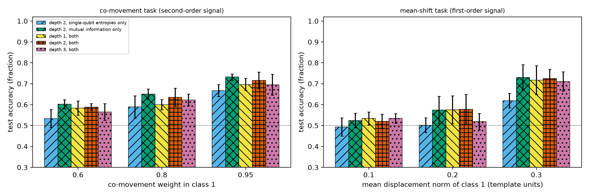
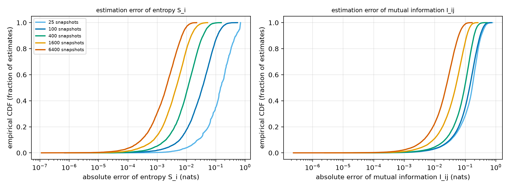
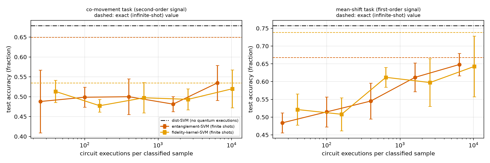
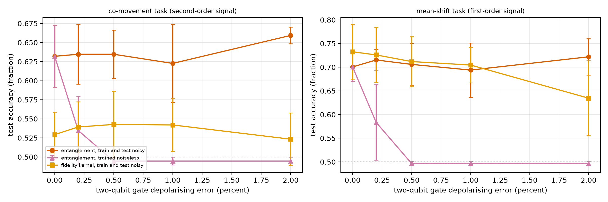

# Does an Entanglement-Entropy Feature Beat the Distances It Is Built From?


[](LICENSE)

[](https://www.python.org/)

[](https://github.com/pradeepdegalaroyal/entanglement-features-vs-distance-baselines/actions/workflows/ci.yml)


**Abstract.** Quantum-inspired "entanglement index" descriptors are reported to improve recognition of coordinated motion, but nobody has isolated whether the entropy structure adds anything beyond the distances that feed it. I built a controlled six-qubit statevector study with a known type of class signal (second-order co-movement versus first-order mean shift), five baselines including a fidelity quantum kernel, a random-Pauli-snapshot cost model and a depolarising-noise sweep. The result is negative and informative: in 32 cells with class signal the entanglement features beat the best classical baseline in 2 cells, by at most 1.07 percentage points (pp), and they need more than 6400 snapshots per sample to approach their exact accuracy. All numbers are simulation results on synthetic data and do not claim any quantum advantage.


## 1. Question and motivation


Quantum Information Entanglement Index (QIEI) features (Rengasamy et al., 2027, digital object identifier (DOI) 10.1007/978-3-032-37667-1_24) turn landmark distances into a quantum state and summarise coordination by von Neumann entropies of reduced states. The idea is attractive for quantum machine learning (QML) pipelines, because the entropies can in principle be measured on a device. Three things are missing from the evidence: a test of whether the entropy map adds information beyond its own input (the distances), the standard quantum baseline of linear quantum models (Jerbi et al., 2023, DOI 10.1038/s41467-023-36159-y), and the measurement cost under noisy intermediate-scale quantum (NISQ) conditions. Full literature table and hypotheses: [`docs/RESEARCH_GAP.md`](docs/RESEARCH_GAP.md). Design: [`docs/METHOD.md`](docs/METHOD.md).


## What is new here


- A controlled test with a *known* signal type, so a win or a loss can be attributed (second-order co-movement versus first-order mean shift), plus a null control at effect size 0.

- The entropy descriptor is compared with three classical baselines **and** a fidelity quantum kernel on the very same quantum state, under identical cross-validation (CV) model selection.

- The descriptor is priced in circuit executions: random-Pauli snapshots and depolarising noise, against the shot cost of the kernel.


## 2. Method in one picture





Legend: radial basis = radial basis function (RBF) support vector machine (SVM); "quadratic" = logistic regression on squared deviations of the distances; CSV = comma-separated values; JSON = JavaScript Object Notation.


Five methods share the same CV model selection: logistic regression (LR) on distances (dist-LR), RBF-SVM on distances (dist-SVM), LR on squared deviations of distances, a fidelity-kernel SVM, and an RBF-SVM on the 21 entanglement features (entanglement-SVM). Two tasks: in the **co-movement** task the landmarks of a region move together in class 1 (per-landmark variance unchanged), in the **mean-shift** task class 1 is displaced by a fixed pattern.


## 3. Hypotheses and outcomes


| Hypothesis (pre-stated in `docs/RESEARCH_GAP.md`) | Verdict | Evidence in `results/` |

|---|---|---|

| H1: entanglement-SVM beats the best classical baseline by at least 3 pp in at least half of the signal cells (co-movement task) | **Rejected** | 0 of 32 signal cells reach +3 pp; mean gain over best classical is -6.62 pp (co-movement) and -4.45 pp (mean-shift); maximum +0.13 pp and +1.07 pp (`summary.json`) |

| H2: no gain on the mean-shift task | Supported | maximum gain over the best classical baseline +1.07 pp, mean -4.45 pp |

| H3: within 2 pp of exact-feature accuracy with at most 1600 snapshots per sample | **Rejected** | co-movement: never within 2 pp up to 6400 snapshots; mean-shift: first within 2 pp at 6400 (`summary.json`, `shots_summary.csv`) |

| H4: at equal executions per sample, descriptor beats shot-limited kernel | **Not supported** | curves overlap within error bars (Figure 4) |


A two-seed pilot was used only to choose effect-size ranges. It already suggested that H1 would fail.


## 4. Results


All numbers below are means over 5 seeds with standard deviation (std) where shown; the null control (effect size 0) sits at chance for every method (mean accuracy 0.489 to 0.500, `summary.json`). Accuracy at 40 training samples (`results/headline_n40.csv`):


| Task, effect | dist-LR | dist-SVM | squared-deviation LR | fidelity kernel SVM | entanglement-SVM |

|---|---|---|---|---|---|

| co-movement, 0.8 | 0.612 ± 0.070 | 0.695 ± 0.043 | **0.719 ± 0.036** | 0.646 ± 0.111 | 0.631 ± 0.053 |

| co-movement, 0.95 | 0.613 ± 0.116 | 0.815 ± 0.041 | **0.861 ± 0.036** | 0.689 ± 0.084 | 0.750 ± 0.040 |

| mean-shift, 0.3 | **0.755 ± 0.049** | 0.739 ± 0.042 | 0.505 ± 0.024 | 0.715 ± 0.017 | 0.706 ± 0.052 |

| mean-shift, 0.4 | **0.837 ± 0.012** | 0.799 ± 0.027 | 0.517 ± 0.061 | 0.821 ± 0.019 | 0.799 ± 0.022 |





*Figure 1. Every method sits at chance for effect size 0; on co-movement a plain classical second-order feature wins, on mean-shift plain distances win, and the entanglement features are never first.*


**Where does the descriptor win?** Over the fidelity kernel in the co-movement task at small training sets: 8 cells gain more than 2 pp over the kernel (7 co-movement, 1 mean-shift), with the maximum +8.4 pp at effect 0.95 and 20 training samples (`paired_gains.csv`). Over all 32 signal cells it beats the kernel in 13, its mean gain over the kernel is +1.1 pp (co-movement) and -1.9 pp (mean-shift). It beats dist-SVM in 9 cells (maximum +1.8 pp and +2.4 pp). Against the best classical baseline it wins 2 cells.





*Figure 2. Blue marks where the entanglement features win; blue regions are small and only appear against the weaker reference (left), almost nowhere against the best classical baseline (right).*


**Ablation (40 training samples).** The mutual-information half carries the signal: co-movement at effect 0.8: entropies only 0.589 ± 0.053, mutual information only 0.650 ± 0.026, both 0.635 ± 0.043; mean-shift at 0.3: 0.619, 0.731, 0.726. Circuit depth 1, 2 and 3 are indistinguishable (co-movement 0.8: 0.600, 0.635, 0.623; `ablation_summary.csv`).





*Figure 3. Dropping the single-qubit entropies costs nothing; dropping the mutual information costs several points, and extra circuit depth buys nothing.*


**Measurement cost.** Errors of the estimated features shrink slowly with the snapshot budget: the median absolute error of the mutual information is 0.023 nats at 6400 snapshots (90th percentile 0.060), larger than the class signal, while the single-qubit entropies are accurate to 0.002 nats (`snapshot_error_quantiles.csv`).





*Figure 4. The empirical cumulative distribution function (ECDF) shows mutual information needs more than 10 times the snapshots of the single-qubit entropies for the same error.*


At 40 training samples the shot-limited accuracies are (`shots_summary.csv`): co-movement, exact entanglement features 0.649, but 0.535 at 6400 snapshots, kernel 0.520 at 256 shots per entry (10240 executions per classified sample), dist-SVM 0.679 with no quantum execution; mean-shift, exact entanglement 0.668, 0.612 at 1600 snapshots and 0.648 at 6400, kernel 0.612 at 640 and 0.643 at 10240 executions, dist-SVM 0.757.





*Figure 5. At equal circuit executions per classified sample the descriptor and the kernel are indistinguishable, and both stay below the free classical baseline.*


**Gate noise.** The global-depolarising proxy rescales every Pauli expectation, so a classifier trained and tested under the same noise is almost unaffected (co-movement 0.632 at 0 percent to 0.659 at 2 percent two-qubit error). The informative case is mismatch: trained on noiseless simulation, the descriptor drops from 0.632 to 0.535 at 0.2 percent two-qubit error and to chance (0.495) at 0.5 percent (mean-shift: 0.701, 0.583, 0.497; `noise_summary.csv`). So the descriptor would have to be re-trained on-device data.





*Figure 6. A model trained on noiseless entropies collapses to chance beyond about 0.5 percent two-qubit error, unless it is re-calibrated on noisy features.*


## 5. Discussion, including negative results


- The entropy features are a fixed, lossy 21-number summary of 15 distances. With an equally flexible learner on the original distances there is little to gain, and the data confirm this. The descriptor did not fail through a bug: its null control is at chance, it is clearly above chance at the larger effect sizes, and the exact Pauli expectations are tested against dense operators (`tests/`).

- The one place with a visible edge is against a generic fidelity kernel when data are scarce on the co-movement task. That is consistent with the descriptor being a better *inductive bias* than a generic kernel, not with any advantage over classical models.

- A simple classical second-order feature (squared deviation) is the best method on co-movement and exactly at chance on mean-shift; the entanglement features sit between both, since they respond to both signal types.

- Estimating mutual information is the cost bottleneck, not the circuit depth.


## 6. Limitations


- Six qubits, synthetic landmark data, exact statevector simulation, five seeds, three or four training-set sizes. Standard deviations are large in several cells; I only quote differences that I call "wins" when the paired mean exceeds the stated threshold, and treat gains below roughly 3 pp as noise.

- The feature map is my own Ising-type map, not the exact QIEI map of the source paper, whose details are not given in the abstract; conclusions are about this family of entropy descriptors.

- The noise model is a global depolarising proxy; the precomputed-kernel regularisation grid is narrow, so the kernel's drop at 2 percent error in the mean-shift task (0.635, `noise_summary.csv`) may partly be an artefact of that grid.

- Real facial landmarks, quantum hardware and different correlation structures were not tested.


## 7. Future work


Run the snapshot estimator on a hardware backend with readout-error mitigation and an experimentally calibrated noise model; test learned feature maps (trainable entanglers) rather than a fixed one; try real landmark data and region-level (multi-qubit) entropies; compare with classical shadows with variance reduction; evaluate the break-even training-set size at which kernel inference cost (training size times shots per entry) exceeds the fixed snapshot cost of the descriptor (not measured here).


## 8. Reproducibility


```bash

pip install -r requirements.txt && pip install -e .

pytest -q                               # 8 fast tests

python experiments/run_all.py --quick   # smoke run, about 35 seconds, writes results/quick/

python experiments/run_all.py           # full study, writes results/ and figures/

```


Full run: about 17.6 minutes (1056 s) on a Windows 11 laptop central processing unit (CPU) with 16 threads, no graphics processing unit used, Python 3.11.9, NumPy 2.2.6, scikit-learn 1.8.0. This is slightly above my 15-minute target because the snapshot sweep dominates (about 60 s per seed and task). Seeds 0 to 4 control all randomness; the log is `results/run_log.txt`.


## 9. Project structure


```

src/entfeat/    data.py circuit.py features.py models.py study.py tables.py plots.py

experiments/    run_all.py            one command for every result and figure

tests/          test_entfeat.py       physics, estimator and pipeline checks

results/        *_raw.csv *_summary.csv headline_n40.csv paired_gains.csv summary.json

figures/        fig1 to fig6 (200 dots per inch)

docs/           RESEARCH_GAP.md METHOD.md

.github/workflows/ci.yml              pytest and the quick run on ubuntu-latest

```


## 10. Related work by the author


- [label-scarce-fraud-qml-vs-classical](https://github.com/pradeepdegalaroyal/label-scarce-fraud-qml-vs-classical): fidelity-kernel and re-uploading circuits versus tuned classical models in a label-scarce regime; the present study asks the same fairness question for entropy features.

- [shot-fair-damped-qng-vqe-benchmark](https://github.com/pradeepdegalaroyal/shot-fair-damped-qng-vqe-benchmark): charges every shot in a variational benchmark, the same accounting idea used here for snapshots.


## Citation


```bibtex

@software{chenchupradeep2026entfeat,

  author   = {Degala Chenchupradeep},

  title    = {Entanglement-Entropy Features versus Distance Baselines: a Controlled Simulation Study with Snapshot and Noise Budgets},

  year     = {2026},

  version  = {0.1.0},

  url      = {https://github.com/pradeepdegalaroyal/entanglement-features-vs-distance-baselines},

  license  = {MIT}

}

```


MIT license (`LICENSE`). Machine-readable citation metadata: `CITATION.cff`.

